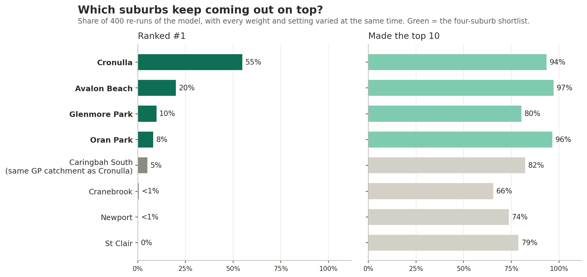
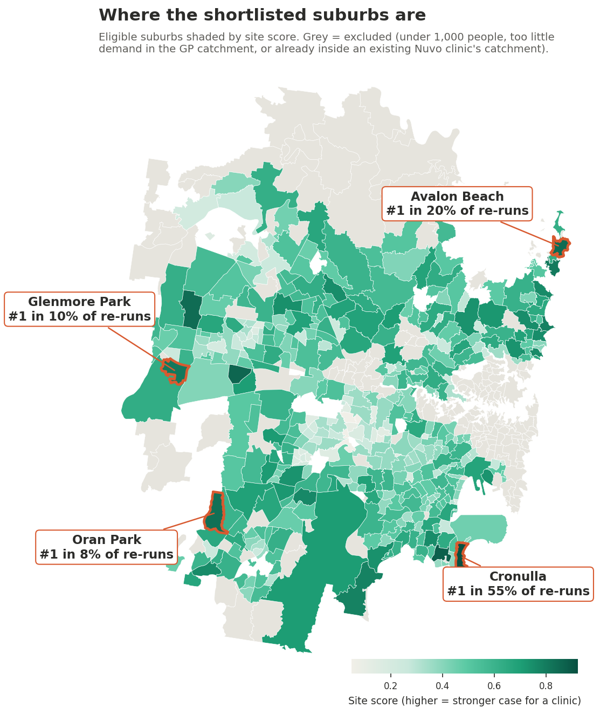
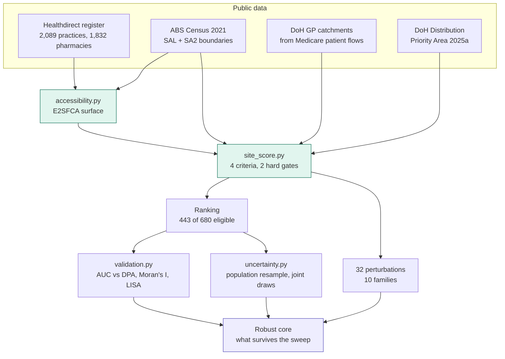
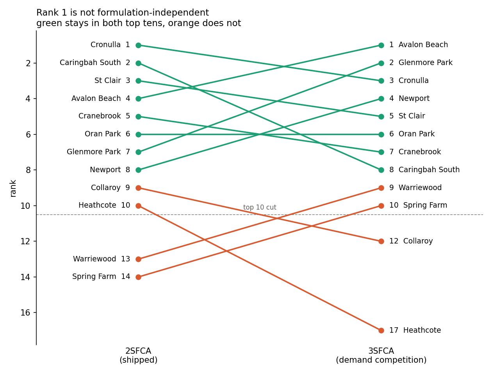
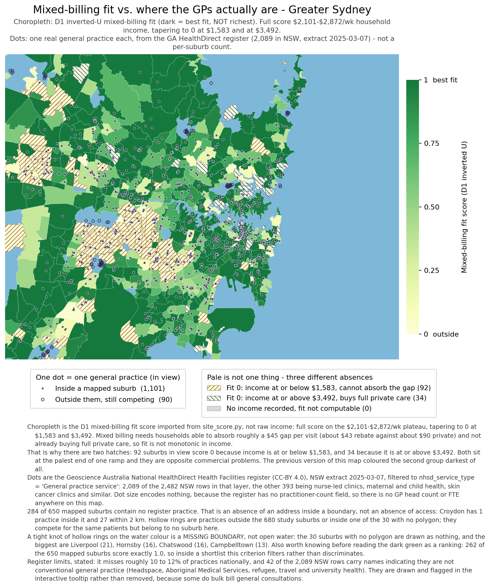
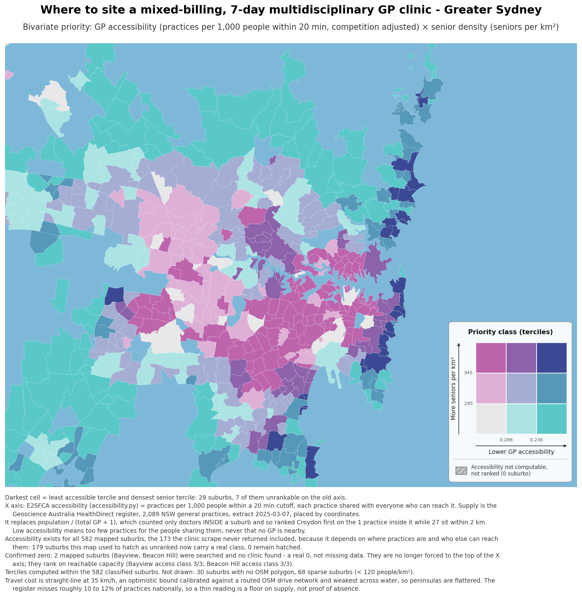

# GP Clinic Site Selection, Greater Sydney

**Where in Sydney should a new GP clinic open?**

This project scores 680 suburbs in Greater Sydney to find where a new mixed-billing GP
clinic (open 7 days, with several types of health professional) would fill the biggest
gap in GP access while still working as a business. The answer is a shortlist of four
suburbs: **Cronulla, Avalon Beach, Oran Park and Glenmore Park**.

**Tools and methods:** Python (pandas, GeoPandas), ABS Census and public health data,
E2SFCA accessibility modelling, weighted multi-criteria scoring, sensitivity testing and
bootstrap resampling.

> **Independent case study.** I used Nuvo Health, a Sydney operator of mixed-billing
> clinics, as the example business. This analysis has no affiliation with Nuvo Health and
> was not commissioned by them. It uses only public data: the Healthdirect practice
> register, Department of Health catchment and priority-area files, ABS Census and
> boundary data, and the operator's own published list of clinic locations. Nothing here
> should be read as their position or as advice given to them.

---

## The problem

Choosing the wrong suburb for a clinic is expensive. If a clinic opens where GPs are
already easy to reach, it mostly competes with existing practices for the same patients.
If it opens where people struggle to reach a GP, it fills a real gap. So the core
question is how thin GP supply is in each suburb, compared with the number of people who
need it.

That is harder to measure than it sounds, and my first ranking got it wrong. **7 of its
top 10 suburbs were places where no GP data had been collected at all.** The pipeline
had recorded "no data" as zero GPs, so the suburbs nobody had measured looked like the
most under-served places in Sydney and floated to the top. Fixing that uncovered three
more problems in how supply and income were measured. Most of this project is about
finding those errors, fixing them, and then testing how much the final answer can be
trusted.

## The answer



The chart shows what happened when I re-ran the model 400 times, changing every weight
and setting at the same time. Cronulla came first in 55% of the re-runs, Avalon Beach in
20%, Glenmore Park in 10% and Oran Park in 8%. All four made the top 10 in at least 80%
of re-runs. This means Cronulla is the most likely winner, but no single suburb wins
every time, so the result I can actually support is a shortlist of four.

Caringbah South also scores well, but it is in the same GP catchment as Cronulla. Two
clinics in one catchment would draw on the same practices and the same patients, so it is
not a separate option.



The map shows that the shortlist is spread across Sydney rather than in one area:
Cronulla in the south, Avalon Beach on the Northern Beaches, and Oran Park and Glenmore
Park on the western and south-western edge of the city.

---

## How the score works

Each eligible suburb gets a score from four criteria:

| Criterion | Weight | What it measures |
|---|---|---|
| Access gap | 40% | How hard it is to reach a GP, counting practices within travel distance and how many other people share them (E2SFCA) |
| Demand | 25% | Population, weighted towards residents aged 65 and over |
| Billing fit | 25% | Household income in the middle of the range, where people can pay a gap fee but are less likely to go fully private |
| Operational | 10% | A pharmacy nearby, and Distribution Priority Area status |

Suburbs are excluded before scoring if they have fewer than 1,000 residents, if their GP
catchment has too little demand, or if they are already inside the catchment of an
existing Nuvo clinic. That leaves 443 of the 680 suburbs.

The weights are my own judgement, so I did not just assert them. Every weight is varied
by ±50% and set to zero in the sensitivity tests.



The recommendation comes from **H**, not **D**. The single ranking is an input to the
robustness tests, not the final output.

| Component | Approach |
|---|---|
| Supply access | E2SFCA, distance-decayed, competition-adjusted |
| Demand | Senior-weighted population on a log ramp |
| Billing fit | Inverted-U on household income, percentile-anchored |
| Operational | Pharmacy co-location + Distribution Priority Area status |
| Robustness | 32 one-at-a-time perturbations, plus 400 joint draws over the same ranges |
| Validation | AUC vs the DoH under-supply flag; Moran's I and LISA; blocked rank bootstrap |
| Uncertainty | 200-replicate population resample calibrated on 2025 ERP |

---

## What was wrong with the first version, and how I fixed it

### 1. Missing data was read as zero supply

239 of 680 suburbs were searched and returned no GP data. Because missing values were
stored as zero, a lack of evidence was treated as evidence of a shortage.

**Fix.** Supply status is now an explicit three-way check in [gp_supply.py](gp_supply.py):
`ok` (433), `gp_count_unknown` (8) and `no_data` (239). Only suburbs that were actually
measured can make a claim about supply. The 247 held out are a list to re-collect, not
rejects.

### 2. Supply was only counted inside suburb boundaries

Croydon ranked #1 with one practice inside its boundary, but it had 27 practices within
2 km. Patients do not stop at suburb lines, so any measure that only counts practices
inside a boundary will favour suburbs that happen to be small.

**Fix.** I replaced the boundary counts with an E2SFCA accessibility measure
([accessibility.py](accessibility.py)). It counts practices across boundaries, gives less
weight to practices further away, and adjusts for how many other people share them.

The Department of Health's own patient-flow catchments back this up:

```
Croydon   -> Strathfield - Burwood - Ashfield
Burwood   -> Strathfield - Burwood - Ashfield
Ashfield  -> Strathfield - Burwood - Ashfield
```

All three suburbs are in one catchment, so the Medicare data treats them as one market.

### 3. Higher income was always treated as better

The original score rewarded higher income without any limit. Its top 20 had a median
household income at the 90th percentile. In other words, it was favouring exactly the
households most likely to choose a fully private clinic over a mixed-billing one.

**Fix.** Billing fit now follows an inverted-U shape ([`mixed_billing_fit`](site_score.py)),
with a plateau in the middle of the income distribution. The cut-offs come from
percentiles of the actual income data rather than fixed dollar amounts, so the 2021
Census year does not quietly change the result.

### 4. Large practices were undercounted

I found this one while fixing the others. The accessibility measure counts **one unit of
supply per practice**, so a suburb served by a few large practices looks under-supplied.
Dee Why ranked #2 even though it had 35 GPs for 23,354 residents, which is better
supplied than 73% of the suburbs in the study.

**Fix.** I added a headcount check that can move a suburb down when its recorded GP
headcount contradicts a high gap score, but can never move it up. It only uses
trustworthy data, and it is one of the sensitivity tests, so the result can also be read
with it turned off. Dee Why moved from rank 2 to 17, Mona Vale from 9 to 42 and Freshwater
from 10 to 12.

---

## How much to trust the result


*Share of the 32 one-at-a-time perturbation runs in which each suburb stays in the top 10.*

**Cronulla** has 17,899 residents and 6 practices within 2 km, and it is thin on both the
accessibility measure and doctors per resident. It stays in the top 10 in **all 32**
perturbation runs, including the four that remove a criterion completely.

**Rank 1 is not settled.** The 32 perturbations change one setting at a time, so they
cannot show what happens when settings interact. When I changed every setting together
over the same ranges, 400 times, Cronulla held rank 1 in **55%** of draws [0.50, 0.60],
Avalon Beach in 20%, Glenmore Park in 10% and Oran Park in 8%. Cronulla held the top 10 in
94% of draws and Avalon Beach in 97%. Cronulla is the most common winner by a clear
margin, but the result I can support is a shortlist of Cronulla, Avalon Beach, Oran Park
and Glenmore Park, not a single name.



*Eight of the ten top-10 suburbs stay in the top 10 when the formula changes, but their
order changes.*

**Rank 1 also depends on the formula.** The tests include a change of method, not just
changes to settings. Under 3SFCA, which adds competition on the demand side and removes a
double-count that 2SFCA has, Avalon Beach is rank 1 and Cronulla is rank 3. Eight of the
ten top-10 suburbs are the same under both. Cronulla is the only suburb that stays in the
top 10 under all 32 one-at-a-time perturbations, although the joint draws above show
that this alone overstates how settled it is.

**Four suburbs survive every run that keeps all four criteria:** Cronulla, Caringbah
South, Avalon Beach and Oran Park.

**Rank 10 is noise.** Heathcote stays in the top 10 in only 45% of runs. Anything below
about rank 8 should be read as "in contention", not as a firm ranking.

**The top 10 is really only 7 opportunities.** Cronulla and Caringbah South share a GP
catchment, as do Avalon Beach and Newport, and Cranebrook and Glenmore Park. Opening in
two suburbs of the same catchment would split the same patients. `final_shortlist_v2.csv`
marks these duplicates rather than dropping them.

---

## What this model does not measure

**It ranks how suitable a suburb is for a mixed-billing clinic as a business. It does not
rank clinical need, and the two point in different directions.**

A mixed-billing practice charges a gap fee, so the model rewards suburbs where households
can afford one. Local Moran's I shows the effect clearly. The only statistically
significant cluster of low-scoring suburbs is in Western Sydney (Merrylands-Guildford,
Fairfield, Bankstown, Mount Druitt and Liverpool). Comparing that cluster with the
high-scoring Northern Beaches cluster gives:

| Criterion | High cluster | Low cluster | Share of the gap |
|---|---|---|---|
| `access_gap` | 0.845 | 0.179 | 64% |
| `mixed_billing_fit` | 0.805 | 0.102 | 42% |

Median household income is $2,481 a week in the high cluster and $1,355 in the low one.
The low cluster's median is *below* the model's lower income cut-off, so those suburbs
score close to zero on billing fit no matter how thin their GP supply is.

This does not mean Western Sydney has enough GPs. It means Western Sydney is a weaker
market for a clinic that charges a gap fee. Only the second claim is supported here.

`community_need_score` in [eda/site_scores_v2.csv](eda/site_scores_v2.csv) looks at it the
other way. It uses the same access and demand measures with the income criterion
reversed, and it is reported for every suburb. It is not used for the ranking because the
brief was commercial.



*The shading is the billing fit score, not raw income: dark means the best fit for a
mixed-billing clinic, not the richest suburb. Each dot is one practice from the register.
Hatched suburbs score zero for opposite reasons. Some are too poor to absorb a gap fee and
others are wealthy enough to choose fully private care.*



*Priority map. The darkest suburbs have both the least reachable GP capacity and the
highest density of residents aged 65 and over.*

---

## Does it work?

I ran two checks in [validation.py](validation.py). The model cannot pass either of them
just because of how it was built.

**Comparison with a government flag.** The Department of Health's Distribution Priority
Area (DPA) flag is an independent under-supply label based on GP full-time equivalents per
person. The score never sees it.

| Measure | AUC | 95% CI |
|---|---|---|
| `access_gap` (unguarded), all 680 | **0.813** | [0.743, 0.879] |
| `access_gap` (unguarded), eligible 443 | 0.719 | [0.586, 0.837] |
| `-log(population)` baseline | **0.849** | [0.809, 0.886] |
| `access_gap` (guarded) | 0.779 | [0.707, 0.846] |
| `site_score` (composite) | 0.641 | [0.576, 0.706] |
| `demand_scale` | 0.240 | [0.208, 0.275] |

The accessibility measure matches the government's classification with an AUC of 0.813.
On its own, though, that number makes the result look better than it is.

**A measure that knows nothing about GP supply does better.** Population alone
(`-log(population)`) scores **0.849** [0.81, 0.89]. DPA-flagged suburbs have a median
population of 815, compared with 5,643 for the rest, so anything linked to small size
scores well on this test.

**The model still carries real supply information.** When population is held roughly
fixed, the model can still tell the two groups apart:

| Population band | n | DPA+ | AUC |
|---|---|---|---|
| 0-1,000 | 96 | 43 | 0.808 [0.71, 0.90] |
| 1,000-5,000 | 248 | 26 | 0.824 [0.71, 0.92] |
| 5,000-15,000 | 262 | 10 | 0.635 [0.38, 0.86] |
| 15,000+ | 74 | **0** | n/a |

**But the check does not reach the suburbs on the shortlist.** The top 10 ranges from
6,148 to 25,021 residents, with a median of 14,473. DPA has only ten flagged suburbs in the
5,000 to 15,000 band and **none above 15,000**. So the external check is strongest where
the shortlist is not. On the 443 eligible suburbs, the composite score's AUC is 0.570
[0.45, 0.67], and that interval includes chance.

**A nested logistic model weakens it further.** `DPA ~ log(population) + access_gap`
beats `DPA ~ log(population)` on a likelihood ratio test (LR 56.5, p = 5.6e-14), but that
test assumes the suburbs are independent. With standard errors clustered on GP catchment,
the access_gap z falls from +6.53 to +1.65 (p = 0.098), and on the eligible suburbs from
+2.75 to +0.87. This is because the flagged suburbs are concentrated: 40 of the 79
DPA-flagged suburbs sit in three catchments, so the simple test counts 40 independent
observations when there are closer to three.

So what I can claim is that `access_gap` measures something real about GP supply, shown
where DPA has enough flagged suburbs to test it. It is not evidence that the ranking of
large metropolitan suburbs has been externally validated, because no outside benchmark in
this project covers them. Two more points come with this. First, the composite scores
*lower* than its own access criterion, because `demand_scale` works against DPA (DPA
suburbs have a median population of 815, while the demand criterion rewards size).
Second, the intervals for the guarded and unguarded measures overlap heavily, so the cost
of the headcount check cannot be told apart from noise.

**Spatial structure.** Global Moran's I, k-nearest-neighbour weights, 999 permutations:

| Measure | I | p |
|---|---|---|
| `access_gap` | 0.623 | 0.001 |
| `mixed_billing_fit` | 0.387 | 0.001 |
| `site_score` | 0.359 | 0.001 |
| `demand_scale` | 0.070 | 0.003 |

Local Moran's I, with a conditional null and Benjamini-Hochberg FDR control, finds 58
significant suburbs out of 443 (124 before correction). **All nine significant high-high
suburbs are on the Northern Beaches.** This means ranks 4, 8 and 9 are really one regional
pattern. The catchment check misses this because Collaroy is in a different
administrative catchment from Avalon Beach and Newport. Cronulla is *not* significant
(p = 0.632), so its score is not explained by a regional cluster.

The Northern Beaches concentration is real, and it is now backed by a test statistic. It
holds across different neighbour counts (I = 0.397 at k=4 down to 0.232 at k=32, p = 0.001
throughout). Clustering is not a flaw in itself, because access to health care really is
spatially structured. However, it means the 443 eligible suburbs are not 443 independent
observations, so any interval calculated as if they were is too narrow.

### Data

All sources are official, dated and can be downloaded again. No LLM-scraped figures
remain in the ranking.

- **2,089 NSW general practices** and **1,832 pharmacies**: Healthdirect National Health
  Services Directory
- **GP catchments**: Department of Health, derived from Medicare patient flows
- **Distribution Priority Area 2025a**: Department of Health
- **ABS** Census 2021 and SAL 2021 boundaries

---

## Limitations

Full detail is in [METHODOLOGY.md](METHODOLOGY.md). These are the ones that could change
a decision:

- **Travel cost is straight-line distance at 35 km/h, not the road network.** This is the
  biggest open weakness. Croydon's accessibility percentile swings from 57.8 to 98.1
  across plausible speed assumptions. The assumption is least accurate across water,
  which matters because part of the ranking follows Sydney's peninsulas.
- **Caringbah South ranks 2 but has no reliable GP headcount**, so the headcount check
  cannot test it. 123 of the 443 eligible suburbs are in the same position.
- **The `area` column is wrong.** Sydney is recorded as 26.47 km² when the actual area is
  2.94. It does not feed into the current score, only the old version, but it is still
  wrong.
- **The list of existing clinics comes from the operator's published site listing**
  (18 GP centres, retrieved 2026-09-23). This replaced a brand-name match that found only
  6 and understated the exclusion threefold. A public listing can still lag behind an
  opening or a closure.
- **Supply data is from March 2025, but demand is from the 2021 Census.** I tested this
  with 200 replicates that resample population growth from 43 checked SA2 matches.
  Cronulla stays at rank 1 in 95% of draws, so the time gap does not overturn the
  recommendation. It does widen the intervals for ranks 7 to 10 to about ±6 ranks.
  Growth areas are systematically ranked too low. For example, Oran Park grew 46% over
  that period.

---

## Repository

```
site_score.py          scoring, sensitivity sweep, self-tests    (1,738 lines)
accessibility.py       E2SFCA surface, travel cost               (1,422)
gp_supply.py           three-way supply status gate
gp_catchments.py       Department of Health catchment join
health_facilities.py   practice and pharmacy register
dpa_status.py          Distribution Priority Area join
validation.py          AUC against DPA, Moran's I under a permutation null  (339)
eda/plot_shortlist.py  the two summary figures at the top of this page
METHODOLOGY.md         method, validation and limitations        (427)
METHODS.md             every statistical method, and what was rejected
```

Outputs are saved in `eda/`: `site_scores_v2.csv` (all 680 suburbs, every sub-score),
`sensitivity_analysis.csv` (one row per suburb per run), `joint_sensitivity.csv` (the 400
joint re-runs) and `final_shortlist_v2.csv`.

```bash
python site_score.py --test
```

```bash
python site_score.py
```

```bash
python eda/plot_shortlist.py
```

Self-checks: 4 assertion cases, 6 data-backed cases, 77 doctests, plus 12 in `validation.py`.

---

## Status

The analysis is complete for the errors above. Three items are still open: 2025 ERP
population, rebuilding the `area` column, and road-network travel time. Travel cost is
the limitation most likely to change the answer, which is why it is listed first.

What I can defend today is the diagnosis of the errors, the method, and Cronulla as the
strongest single candidate within a four-suburb shortlist.
