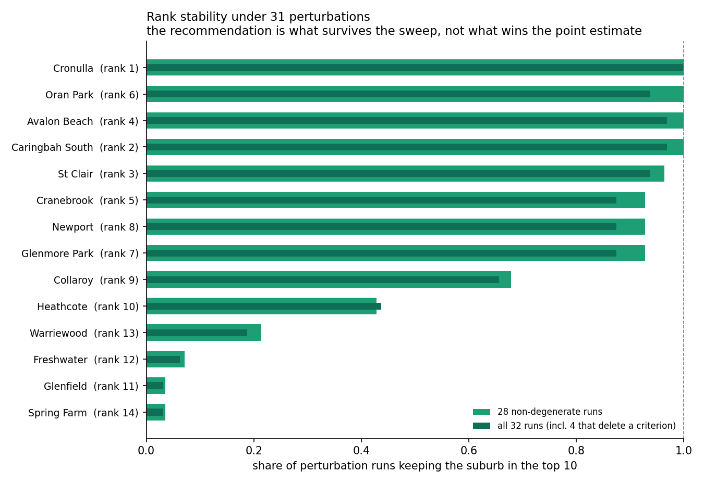

# Nuvo Health — GP clinic site selection, Greater Sydney

Where should a mixed-billing, 7-day, multidisciplinary GP clinic open in Greater Sydney?

680 suburbs scored on how thin GP supply is against the demand that must share it. The
interesting part of this repository is not the ranking. It is that **the first ranking
was wrong, the errors were structural rather than cosmetic, and each one is documented
with the evidence that exposed it.**

---

## The short version

The original top 10 had **7 suburbs that had never returned any supply data at all.**

The pipeline recorded "no data" as `total_gp = 0`. Pressure was computed as
`population / (total_gp + 1)`. So the suburbs nobody had measured scored as maximum
pressure and floated to the top. The answer was an artefact of its own missing-data
handling.

Fixing that exposed two more structural errors underneath it. All three are described
below, and the current answer is deliberately narrower than the original one.

---

## Three structural errors, and how each was caught

### 1. Missing data read as zero supply

239 of 680 suburbs were queried and returned nothing. Because absence was encoded as
zero, absence of evidence became evidence of scarcity.

**Fix.** Supply status is now an explicit three-way gate in [gp_supply.py](gp_supply.py):
`ok` (433), `gp_count_unknown` (8), `no_data` (239). Only measured suburbs can make a
supply claim. The 247 held out are a re-scrape work list, not rejects.

### 2. Supply counted inside suburb boundaries

Croydon ranked #1 with one practice inside its polygon — and 27 within 2 km. Patients do
not stop at suburb lines, so any measure that counts supply inside a boundary will
reward suburbs that happen to be small.

**Fix.** Polygon counts replaced with an E2SFCA accessibility surface
([accessibility.py](accessibility.py)) — distance-decayed, competition-adjusted, and
computed across boundaries.

The Department of Health's own patient-flow catchments settle it independently:

```
Croydon   -> Strathfield - Burwood - Ashfield
Burwood   -> Strathfield - Burwood - Ashfield
Ashfield  -> Strathfield - Burwood - Ashfield
```

One catchment. The Medicare data agrees the three suburbs are one market.

### 3. Income treated as monotonically better

The original score rewarded higher income without limit. Its top 20 had a median
household income at the 90th percentile — it was optimising for exactly the households
most likely to choose private billing over a mixed-billing clinic.

**Fix.** An inverted-U fit ([`mixed_billing_fit`](site_score.py)) with a plateau in the
middle of the distribution, derived from percentiles of the actual income data rather
than hardcoded dollars, so the 2021 Census vintage cancels out instead of being a silent
dependency.

### And a fourth, found while fixing the others

The accessibility surface counts **one unit of supply per practice**, so a suburb served
by few but large practices reads as under-supplied. Dee Why ranked #2 while carrying 35
GPs against 23,354 residents — better supplied than 73% of the cohort.

**Fix.** A headcount *demotion guard*: recorded headcount may contradict a high gap
score, but never produce one. It only moves suburbs down, only fires on trustworthy data,
and is itself one of the sensitivity families so the answer can be read with it off.
Dee Why moved from rank 2 to 19.

---

## The current answer, and how much of it to believe



**Cronulla** — 17,899 residents, 6 practices within 2 km, thin on both the accessibility
measure and on doctors per resident. It holds the top 10 in **all 31** perturbation
runs, including the four that delete a criterion outright.

**Four suburbs survive every non-degenerate run:** Cronulla, Caringbah South,
Avalon Beach, Oran Park.

**Rank 10 is noise.** Heathcote holds the top 10 in 45% of runs. Anything below about
rank 8 should be read as "in contention", never as a ranking.

**The top 10 is only 7 opportunities.** Cronulla and Caringbah South share a GP
catchment, as do Avalon Beach and Newport, and Cranebrook and Glenmore Park. Two suburbs
in one catchment draw on the same practices and the same population, so opening in both
cannibalises. `final_shortlist_v2.csv` marks the duplicates rather than dropping them.

The recommendation is the set that survives the sweep. It is not the point estimate.

---

## What this model is not

**It ranks commercial suitability for a mixed-billing clinic. It does not rank clinical
need, and the two point in different directions.**

A mixed-billing practice charges a gap fee, so the model rewards suburbs where
households can pay one. Local Moran's I makes the consequence explicit: the only
statistically significant cluster of low-scoring suburbs is in Western Sydney —
Merrylands-Guildford, Fairfield, Bankstown, Mount Druitt, Liverpool — and decomposing
the gap between that cluster and the high-scoring Northern Beaches cluster gives:

| Criterion | High cluster | Low cluster | Share of the gap |
|---|---|---|---|
| `access_gap` | 0.845 | 0.179 | 64% |
| `mixed_billing_fit` | 0.805 | 0.102 | 42% |

Median household income is $2,481 a week in the high cluster and $1,355 in the low one.
The low cluster's median sits *below* the model's lower income knot, so those suburbs
score near zero on billing fit regardless of how thin their GP supply is.

Stated plainly: the model is not claiming Western Sydney has enough GPs. It is claiming
Western Sydney is a poor market for a clinic that charges a gap fee. Those are different
claims and only the second one is supported here.

`community_need_score` in [eda/site_scores_v2.csv](eda/site_scores_v2.csv) applies the
opposite lens — the same access and demand measures with the income criterion inverted —
and is reported for every suburb. It is never ranked on by default, because the brief was
commercial.

---

## Method

| Component | Approach |
|---|---|
| Supply access | E2SFCA, distance-decayed, competition-adjusted |
| Demand | Senior-weighted population on a log ramp |
| Billing fit | Inverted-U on household income, percentile-anchored |
| Operational | Pharmacy co-location + Distribution Priority Area status |
| Robustness | 31 perturbations across 9 families, 21,760 rows |
| Validation | AUC vs the DoH under-supply flag; Moran's I and LISA; blocked rank bootstrap |

Weights are 0.40 access / 0.25 demand / 0.25 billing fit / 0.10 operational — and they
are not defended by assertion. Every one is varied by ±50% and to zero in the sweep.

### Does it work?

Two checks in [validation.py](validation.py), neither of which the model can pass by
construction.

**External discrimination.** The Department of Health's Distribution Priority Area flag
is an independent under-supply designation derived from GP FTE per capita. The score has
never seen it.

| Measure | AUC | 95% CI |
|---|---|---|
| `access_gap` (unguarded) | **0.813** | [0.743, 0.879] |
| `access_gap` (guarded) | 0.779 | [0.707, 0.846] |
| `site_score` (composite) | 0.641 | [0.576, 0.706] |
| `demand_scale` | 0.240 | [0.208, 0.275] |

The accessibility surface reproduces the government's own classification at AUC 0.813.
Two readings travel with it: the composite scores *lower* than its own access criterion,
because `demand_scale` anti-predicts DPA — DPA suburbs have a median population of 815
while demand rewards size — and the intervals for the guarded and unguarded measures
overlap heavily, so the guard's apparent cost is not distinguishable from noise.

**Spatial structure.** Global Moran's I, k-nearest-neighbour weights, 999 permutations:

| Measure | I | p |
|---|---|---|
| `access_gap` | 0.623 | 0.001 |
| `mixed_billing_fit` | 0.387 | 0.001 |
| `site_score` | 0.359 | 0.001 |
| `demand_scale` | 0.070 | 0.003 |

Local Moran's I, with a conditional null and Benjamini-Hochberg FDR control, finds 58
significant suburbs of 443 (124 before correction). **All nine significant high-high
suburbs are Northern Beaches** — so ranks 4, 8 and 9 are one spatial phenomenon, which
the catchment dedupe misses because Collaroy sits in a different administrative catchment
from Avalon Beach and Newport. Cronulla is *not* significant (p = 0.632), meaning its
score is not explained by a regional cluster.

The peninsula concentration is real and now has a test statistic rather than an anecdote.
It is stable across neighbour counts (I = 0.397 at k=4 down to 0.232 at k=32, p = 0.001
throughout). Clustering is not itself a defect — health access genuinely is spatially
structured — but it means the 443 eligible suburbs are not 443 independent observations,
so any interval computed as though they were is too narrow.

### Data

All authoritative, dated and re-fetchable. No LLM-scraped figures remain in the ranking.

- **2,089 NSW general practices** and **1,832 pharmacies** — Healthdirect National Health
  Services Directory
- **GP catchments** — Department of Health, derived from Medicare patient flows
- **Distribution Priority Area 2025a** — Department of Health
- **ABS** Census 2021 and SAL 2021 boundaries

---

## Honest limitations

Full detail in [CAVEATS.md](CAVEATS.md). The ones that would change a decision:

- **Travel cost is straight-line at 35 km/h, not road network.** This is the largest
  open weakness. Croydon's accessibility percentile swings from 57.8 to 98.1 across
  plausible speed assumptions, and the assumption is least accurate across water — which
  matters, because the ranking is partly a map of Sydney's peninsulas.
- **Caringbah South ranks 2 but has no trustworthy headcount**, so the demotion guard
  cannot check it. 123 of 443 eligible suburbs are in that position.
- **The `area` column is corrupted** — Sydney recorded at 26.47 km² against 2.94 actual.
  It feeds no part of the current score, only the superseded chain, but it is wrong.
- **The existing-clinic exclusion list now comes from the operator's published site
  listing** (18 GP centres, retrieved 2026-09-23), replacing a brand-string match that
  found only 6 and understated the exclusion threefold. A public listing can still lag
  an opening or a closure.
- **Supply is March 2025, demand is the 2021 Census.** Growth corridors are
  systematically under-ranked; Oran Park grew 46% over that window.

---

## Repository

```
site_score.py          scoring, sensitivity sweep, self-tests    (1,843 lines)
accessibility.py       E2SFCA surface, travel cost               (1,422)
gp_supply.py           three-way supply status gate
gp_catchments.py       Department of Health catchment join
health_facilities.py   practice and pharmacy register
dpa_status.py          Distribution Priority Area join
validation.py          AUC against DPA, Moran's I under a permutation null  (339)
METHODOLOGY.md         every decision and why                    (406)
CAVEATS.md             every known weakness                      (367)
```

Outputs land in `eda/`: `site_scores_v2.csv` (all 680, every sub-score),
`sensitivity_analysis.csv` (one row per suburb per run), `final_shortlist_v2.csv`.

```bash
python site_score.py --test
```

```bash
python site_score.py
```

Self-checks: 4 assertion cases, 6 data-backed cases, 77 doctests, plus 12 in `validation.py`.

---

## Status

Analysis complete for the errors above; three items remain open — 2025 ERP population,
the `area` rebuild, and road-network travel time. The travel-cost limitation is the one
that would most change the answer, and it is stated rather than buried.

What is defensible today: the diagnosis, the method, and Cronulla. Not a ranked ten.
